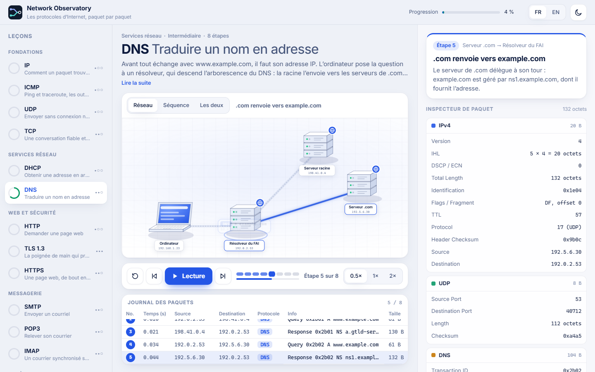

**Language / Langue:** [🇫🇷 Français](README.md) · 🇬🇧 **English**

# Network Observatory

**Understand network protocols, one packet at a time.**

Network Observatory is an interactive, bilingual (French / English) learning lab. Its **17 animated lessons** explain how machines communicate: packet paths, device-to-device exchanges, and protocol contents, right down to individual bytes.



## What you can explore

- **Animated network map** showing devices, hops, broadcasts, and packet loss.
- **Synchronized sequence diagram** where exchanges unfold alongside the simulation.
- **Packet inspector** with decoded fields, hexadecimal bytes, and interactive highlighting between the two views.
- **Playback controls** for play, pause, step-by-step exploration, adjustable speed, keyboard shortcuts, saved progress, and light/dark themes.
- **Bilingual, responsive interface** for desktop and mobile, in French and English.

## All 17 lessons

| Category | Protocols |
| --- | --- |
| Foundations | IPv4, ICMP, UDP, TCP |
| Dynamic routing | **RIPv2, OSPFv2, BGP-4** |
| Network services | DHCP, DNS |
| Web and security | HTTP, TLS 1.3, HTTPS |
| Email | SMTP, POP3, IMAP |
| Remote access and file transfer | SSH, FTP |

The three routing labs cover **RIP convergence**, **OSPF Hello messages, LSAs and SPF**, and **BGP sessions and route announcements**. A [routing course with exercises (in French)](docs/LESSONS_ROUTING.md) accompanies the animations.

Topologies include only devices relevant to the protocol being taught—no arbitrary "core network" device.

## Real packet structures, not just decorative arrows

The engine builds packets **field by field**, with consistent lengths, checksums, and sequence numbers. Tests cover IPv4, TCP, UDP, ICMP, DNS, DHCP, TLS, SSH, RIP, OSPF, and BGP, among other invariants.

**Scope:** lessons are deterministic, deliberately simplified teaching scenarios. They are **not live packet captures or a routing emulator**: routing tables and SPF are not recalculated in real time from an editable topology.

## Run locally

**Requirements:** Node.js 22 or newer.

```bash
cd app
npm ci
npm run dev
```

Then open [http://localhost:5173](http://localhost:5173).

### Validate changes

```bash
cd app
npm run typecheck
npm test
npm run build
```

Browser tests run separately with `npm run test:e2e` (Playwright browsers must be installed).

**Tech stack:** TypeScript, Vite, SVG; no UI framework or application runtime dependencies. See the [`app/` technical guide](app/README.md).

## Deployment and integration

- **Coolify / Docker:** use the root [Dockerfile](Dockerfile), exposing port **80**. The image build runs the TypeScript checks, unit tests, and production build before packaging the site with Nginx. See the [deployment guide (in French)](docs/DEPLOY_COOLIFY.md).
- **Sentinel Campus:** an `iframe` mode supports scenario, language, and theme settings, with origin-validated `postMessage` communication. See the [embed integration contract (in French)](docs/EMBED_CAMPUS.md).

## Documentation

- [Application architecture and adding a lesson (French)](app/README.md)
- [RIP, OSPF and BGP routing course (French)](docs/LESSONS_ROUTING.md)
- [Protocol RFC references (French)](docs/PROTOCOL_REFERENCES.md)
- [Release validation checklist (French)](docs/RELEASE_GATES.md)
- [Licenses and attribution (French)](docs/RIGHTS_AND_ATTRIBUTIONS.md)

## License and credits

© 2026 **Neosoda**, released under the [MIT license](LICENSE). The **Inter** font uses the SIL Open Font License 1.1; details and credits are listed in [`docs/RIGHTS_AND_ATTRIBUTIONS.md`](docs/RIGHTS_AND_ATTRIBUTIONS.md).
