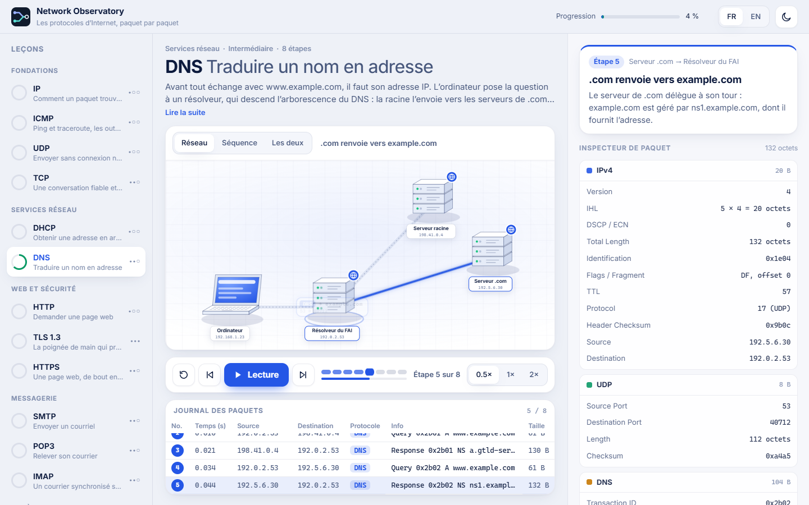

# Network Observatory

**Les protocoles d’Internet, paquet par paquet.** 17 leçons animées où l’on suit chaque message sur une carte du réseau et dans un diagramme de séquence, avec le paquet complet décodé octet par octet. En français et en anglais.



## Leçons

| Fondations | Routage dynamique | Services réseau | Web et sécurité | Messagerie | Accès distant et fichiers |
|---|---|---|---|---|---|
| IP, ICMP, UDP, TCP | RIPv2, OSPFv2, BGP-4 | DHCP, DNS | HTTP, TLS 1.3, HTTPS | SMTP, POP3, IMAP | SSH, FTP |

Chaque leçon propose :

- **une carte réseau animée** : le paquet voyage de saut en saut, les pertes et les diffusions sont représentées ;
- **un diagramme de séquence** synchronisé, où chaque flèche se trace au rythme du paquet ;
- **un inspecteur** qui reconstruit le paquet (IPv4, TCP/UDP/ICMP, puis DNS, DHCP, HTTP, TLS, SSH…) : survoler un champ allume ses octets dans le dump hexadécimal, et inversement ;
- lecture, pas à pas, vitesse, raccourcis clavier (Espace, ← →, 1 2 3), progression mémorisée, thème clair ou sombre.

Les paquets sont **construits par le code** à partir de leurs champs : sommes de contrôle IP, TCP, UDP et ICMP réelles, numéros de séquence TCP cohérents d’un bout à l’autre, messages DNS et DHCP conformes, enregistrements TLS et paquets SSH aux bonnes longueurs, trames RIP et BGP conformes et LSA OSPF avec somme Fletcher. Les adresses sont des plages de documentation (RFC 5737) ou privées (RFC 1918). Les tests vérifient ces invariants.

Un [cours de routage détaillé](docs/LESSONS_ROUTING.md) accompagne les trois nouveaux laboratoires, avec exercices et références RFC. Les topologies n’ajoutent pas de « cœur de réseau » si ce rôle ne sert pas l’explication.

## Développement

```bash
cd app
npm ci
npm run dev        # http://localhost:5173
npm run typecheck
npm test
npm run build      # build + contrôle de l'artefact
```

Node 22 ou plus récent. Détails techniques : [app/README.md](app/README.md).

## Déploiement

Coolify, stratégie **Dockerfile** à la racine, port **80**. L’image compile l’application (typecheck, tests, build) puis la sert avec Nginx. Voir [docs/DEPLOY_COOLIFY.md](docs/DEPLOY_COOLIFY.md).

## Licence

Code et contenus : [MIT](LICENSE), © 2026 Neosoda. Police Inter : SIL Open Font License 1.1 ([détails](docs/RIGHTS_AND_ATTRIBUTIONS.md)).
